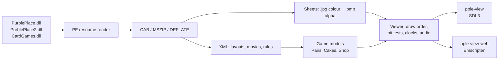

# Purble Place — Rebuilt from Reverse Engineering

[](https://github.com/Areshkew/purble-place-decomp/actions/workflows/pages.yml)


**Purble Place** shipped with Windows Vista and Windows 7: three small puzzle games for children
whose artwork, layouts and rules are sealed inside three PE resource DLLs, with no source, no
published formats and no way to build them for another platform. This project takes that closed box
apart and rebuilds what is inside it in C++20 — the main menu, Purble Pairs, Comfy Cakes and Purble
Shop — working from static analysis of the shipped binaries: their PE resources, their XML layouts,
their skeletal animations and the code that decides the rules.

No original Microsoft source code and no game assets are part of this repository. The binaries are
never modified; the tools read the game's own files from your own installation at run time.

**[▶ Play the WebAssembly build in your browser](https://areshkew.github.io/purble-place-decomp/)** ·
**[Source code](https://github.com/Areshkew/purble-place-decomp)** ·
[Reverse engineering](#reverse-engineering-deep-dive) ·
[Build it](#building-from-source)

- **Playable today:** the real main menu and all three mini-games, each a whole round with its own
  difficulty selection, scoring, tips, sound and the engine's own double-DPI (`x2`) art.
- **Two builds, one source list:** a native SDL3 viewer (`pple-view`) and the Emscripten page
  (`pple-view-web`) published to GitHub Pages.
- **No game data in the repository:** assets are read from the `PurblePlace*.dll` / `CardGames.dll`
  you supply, so clone size and licensing stay clean.
- **The rules are measured, not guessed:** every behavioural claim in the code cites the address it
  was recovered from, and 5 CTest suites plus per-screen regression runs check it against the
  shipped data.

## See it running

The fastest look at the finished result is the published browser build:

**<https://areshkew.github.io/purble-place-decomp/>**

It is the same viewer compiled to WebAssembly, rebuilt and deployed from `main` by
[`.github/workflows/pages.yml`](.github/workflows/pages.yml). It opens on a file picker, because
the site ships no Microsoft files: select your own `PurblePlace.dll`, `PurblePlace2.dll`,
`CardGames.dll` and `en-US\PurblePlace.exe.mui`, and the main menu appears with its four houses,
its drifting clouds and each building's own hover art.

**What you will see, screen by screen:**

| Screen | What it is |
|---|---|
| Main menu | The classroom background, four building hot-spots, hover art from each button's own `<Animation>`, and the loading screen on the transitions |
| Purble Pairs | A dealt board of the game's own card art, the jar and its coin animations, the Professor's tips, the progress meter and, on timed difficulties, the segmented time bar |
| Comfy Cakes | The kitchen with six tool machines, the conveyor belt, the TV showing the target cake, the Purble Chef, and the dispatch chute with its box and trash can |
| Purble Shop | The Build-a-Purble room: the cabinet and its shelves, the curtain over the mystery head, the guess purble, the deduction check boxes and the guess history strip |

<!--
  SCREENSHOT SLOTS — maintainer note, deliberately not rendered on GitHub.

  This repository commits no gameplay captures: every pixel of a capture is Microsoft's artwork,
  and the project's stated rule is that none of the game's art is in the tree (see AGENTS.md and
  .github/workflows/pages.yml). The demo page above is the visual proof until that call is
  revisited.

  If the captures are ever committed, the four images this section would feature are

    docs/screenshots/menu.png    the main menu, its four houses and the drifting clouds
    docs/screenshots/pairs.png   Purble Pairs, Advanced: the board, the jar, the time bar
    docs/screenshots/cakes.png   Comfy Cakes, Beginner: the belt, the TV target and the Chef
    docs/screenshots/shop.png    Purble Shop, Intermediate: the cabinet and the guess purble

  written as one two-column Markdown image table with alt text naming the screen. A game-area
  capture is one command, with your own installation path in $d:

    .\build\pple-res\pple-view.exe "$d\PurblePlace.dll" "$d\PurblePlace2.dll" "$d\CardGames.dll" `
      --menu --mui "$d\en-US\PurblePlace.exe.mui" --mute --shot menu.ppm

  --shot writes a PPM at one pixel per game pixel with the diagnostic strip above it; crop the
  strip off (its height is printed in the run's "HUD strip N px" line) and convert with
  C:\re\traces\cpp\ppm2png.py, or add --no-debug to drop the strip from the capture. Do not
  hotlink C:\re\traces\cpp, which is not part of the repository.
-->

## What is this project?

Purble Place is a nostalgia object for anyone who grew up on Windows Vista or Windows 7, and a
good target for reverse engineering: small, self-contained, unusually data-driven, shipped without
symbols, and made of exactly the kind of hand-written C++ that casts a long shadow when you change
one field's meaning.

The interesting part is not that the three games can be rewritten. It is that the original is
almost entirely a data interpreter, and the reconstruction had to reproduce the interpreter, not
copy the data:

- The **assets** are PE resources inside three DLLs, many of them Cabinet archives holding MSZIP
  blocks, decoded at load time and named by a resolution rule with several non-obvious rewrites.
- The **UI** is XML: 840 layout documents whose nodes name sheets, frames, animations, movies and
  sound events, and whose "widgets" are documents that point at other documents.
- The **animation** is skeletal movies with keyframed parts, evaluated per 30 Hz tick.
- The **rules** — card pools, cake generation, difficulty tables, guess comparison, scoring and
  rank — are C++ behind vtables and magic offsets, and had to be read back out of the disassembly.

**Decompilation, reverse engineering and this project are three different things.** Decompilation
turns machine code into a source listing (Hex-Rays, Ghidra) that no one may redistribute here; the
original shipped build was never decompiled wholesale and no recovered listing is in this tree.
Reverse engineering is the analysis — disassembly, decompilation of individual functions, resource
parsing and runtime observation — that produced the described behaviour. This repository is a
**clean reimplementation**: new C++20 written against that description, checked against the
original's own data and against captured output. Function names like `ConcentrationBoard::click`
or `ConveyorBelt::SlideLeft` are recovered labels used to label the reconstruction, each paired
with the address it came from; they are not authoritative Microsoft symbols.
[`tools/pple-res/README.md`](tools/pple-res/README.md) and the viewer module map document claims
that way throughout, and `AGENTS.md` records which behaviours are settled and must not regress.

## Features

### The three mini-games

| Mini-game | Difficulties | What is implemented | Headless hook |
|---|---|---|---|
| **Purble Pairs** (internally *Concentration*) | Beginner, Intermediate, Advanced; 1 / 2 / 4 boards a round | Data-driven decks from `CARDS.XML`, deal-in, flips, match and mismatch countdowns, take-back clicks, the special cards (Chef, Mixer, Time Bonus and Wild) and the card carrying the sneak-peek eye, jar coins with arc flight and burst movie, progress meter, time bar, rank scoring, save and resume | `--pairs D,L,S`, `--pairs-solve`, `pple-res pairs --autoplay` |
| **Comfy Cakes** | Beginner, Intermediate, Advanced | The kitchen room in the engine's draw order, the conveyor belt and its tools, wax paper, the TV target, cake assembly, judging, Game Points and Final Score with the moves band, the round clock, dispatch to the box or the trash, and the Purble Chef's six-state machine | `--cakes D`, `--cakes-solve` |
| **Purble Shop** (internally *Build-a-Purble*) | Beginner, Intermediate, Advanced | The cabinet with one visible variant per colour and feature, selection and clearing, deduction check boxes, the guess purble, the two feedback counts, the scrollable history strip, the curtain intro and answer reveal, scoring and the shared end-of-round panel | `--shop D`, `--shop-seed N`, `--shop-guess S` |

All three are reachable from the main menu's own hot-spots, which open the in-canvas **Select
Difficulty** screen, and directly from the command line for analysis runs. `--pairs-solve`,
`--cakes-solve` and a scripted `--shop-guess` play a round out through the same click handlers the
mouse uses, which is how the end-to-end checks stay honest.

### Shared systems

- **C++20, standard library only in the core.** `pple_core` implements the PE reader, CAB/MSZIP,
  DEFLATE, PNG decode and encode, XML, sprite scenes, movies, the animation timeline, the three
  game models, the MUI string table, the RGMH save container and SHA-256 with no third-party code.
  `pple_audio` adds Media Foundation for WMA, and the viewer adds SDL3.
- **SDL3 viewer.** `pple-view` renders the engine's own draw order, reconstructs the pointer's
  *focus* (the engine has no separate hover: `ProcessMouseMove` hit-tests the node under the cursor
  and `SetFocus` sends `FocusGot`/`FocusLost`, so exactly one node is focused and its own second
  `<Animation>` is the highlight), and runs the Professor's, the Chef's, the curtain's and the
  belt's clocks on the same 30 Hz tick as the game.
- **WebAssembly.** The same source list builds `pple-view-web` through Emscripten. SDL3,
  SDL3_ttf and libjpeg come from Emscripten's own ports; SDL3_image has no port, so the web build
  takes the small JPEG decoder in `src/viewer/jpeg.cpp`. The game's files are written into the
  Emscripten file system before `main` runs and are never part of the build.
- **The engine's own double-DPI art.** `--hidpi` draws every sheet from the `x2` resources the
  engine selects on a high-DPI display, including the four-page split sheets in `SPLITLIST.XML`.
  Layout, hit tests and destination rectangles stay identical between the modes; only the texels
  read change. Below a 1.5x window scale the 1x art is used automatically.
- **Localisation.** Labels in the XML are `|id|context|English` references resolved against the
  shipped `.mui` (786 strings in the English table); without one, the English text embedded in the
  XML is used, which is why the title font changes.
- **Audio.** Every shipped effect is WMA/ASF. The desktop decodes them through Media Foundation —
  the project's only platform decoder — and can write a **WAV pack** so the browser build, whose
  platform has no WMA decoder, still has sound.

## Reverse engineering deep dive

The reconstruction is only as good as the analysis behind it. These are the parts that needed real
work, in the order the data meets the code.

**Resources are not files.** Every asset lives inside three DLLs, each of them a bare `.rsrc`
section and nothing else: 976 resources in 27.3 MB of `PurblePlace.dll`, 164 in 8.0 MB of
`PurblePlace2.dll` and 224 in 5.9 MB of `CardGames.dll` — 85 Cabinet archives, 201 WMA effects,
and the rest JPEG and PNG sheets and XML layouts. Because those containers have to be opened
without Windows, the project carries its own DEFLATE decoder and CAB reader rather than calling the
platform APIs: `pple-res verify` inflates **every** CAB resource and checks each block against its
`cbUncomp` and the total against `CFFILE.cbFile`. Resolution is not a simple lookup either.
`DllFileMgr::LoadResource` (`0x1000BBF00`) folds `/` to `\`, searches every loaded module, and on a
miss appends `.cab` and inflates the container; sheet names get a rewrite that splits one request
into two resources, and audio names are resolved under `AUDIO\SFX\`.

**A sheet is two files.** `<stem>.sht` resolves to `<stem>.jpg`, opened as the **colour** sheet,
and `<stem>.bmp`, which exists only as `<stem>.BMP.CAB` and is the **alpha** sheet.
`ResourceTextureD3D::CreateTextureFromSheet` (`0x1000A83DC`) demands equal dimensions and composes
`ARGB = (alpha << 24) | (colour & 0xFFFFFF)` into a texture at the next power of two above each
dimension, filling only the top-left `w x h`. That last detail explains a fact that is otherwise
inexplicable in the XML: `<SheetOffsetX>` and `<SourceWidth>` are in *padded texture* space, not
file space — the only way `<PlayArea>`'s `148,0 800x500` fits an 800x496 PNG whose texture is
1024x512.

**The UI is data, and reference resolution is a real parser problem.** Parsing all 840 XML
documents yields 3652 resource references of which 3047 resolve: 2039 exactly, **1008 through the
`.sht`→`.jpg` rewrite** and 147 through the `AUDIO\SFX\` prefix. The 240 distinct references that
do not resolve (464 occurrences) are content variants that were never shipped; the original loader
tolerates misses, so the reconstruction does too. A `<Desc>` that carries no node of its own is a
**widget** — `GetDescNode` (`0x100072E80`) follows the document it names and `SetWidgetPos`
(`0x100072F20`) places it at the outer X/Y — and the engine builds some rooms by *creating* nodes
rather than walking the document, which is why `cakes_screen.cpp` and `shop_screen.cpp` carry the
engine's own creation order as their draw order.

**Movies are skeletal, and keyframes are steps.** `<Movie>` documents place parts per frame;
`pple::movie_evaluate` gives every part the value of the last `<Frame num=>` at or before the
drawn frame, because the engine applies a key only on its own frame number. Interpolating looks
harmless and is visibly wrong: several parts are authored to snap between alpha 0 and 100, so a
tween mixes the open eye with the closed lid and spreads the exit's one-frame blur flash across
the whole movie.

**The rules came out of the code, not out of guessing.** A few examples of what the analysis
pinned down, each cited by address in the source:

- Comfy Cakes' `LayerOperations::GetLayerOperation` (`0x10006F1F0`) indexes a 6x6 table at
  `0x100014430` whose **row is the top layer's class, not the tool's station**; operation 2
  consumes the layer it replaces, so batter on a pan removes the pan and no generated target
  carries one.
- `ConveyorBelt::SetCakePosition` (`0x100063074`) puts slot 0 off the belt at `(66,-115)` and slot
  `p ≥ 1` at `(98p-66, 29)`; `SlideLeft`'s own loop order makes each slide move a cake exactly one
  slot.
- Purble Pairs' `Card::UpdateFlipForward` (`0x10007EA20`) narrows the visible side by 17% a tick
  to a 15% floor and widens the other back to 100%, so a flip is 5 + 5 ticks and `Card::OnReveal`
  runs the match test only after it — not a shape anyone would guess from playing.
- The sneak-peek reveal is `/SneakRevealDuration` = 45 raw ticks armed *after* the flip, while
  `/SneakPeakIconDur` only drives the mini-icon schedule; the cost is
  `/SneakTimeDecrement` percent of the level budget (315 ticks on Intermediate, 270 on Advanced,
  zero on Beginner).
- Purble Shop's `Face::Compare` (`0x100069F18`) scores *right colour in the right place* and, on
  Advanced only, *right colour in the wrong place*, against the hidden face's colour multiset;
  `Constants.xml` gives the guess limits as 7 and 13, and Beginner is unlimited
  (`MakeGuess`'s `v21 != 0` test).
- End-of-round scoring is a formula, not a score: `CalcEndGame` (`0x100080718`) adds
  `points + time bonus + flip bonus`, so Beginner is `410 + 0 + 2300 = 2710`, Intermediate
  `1180 + 3000 + 3000 = 7180` and Advanced `4040 + 5000 + 5000 = 14040`, all rank 5,
  "Purble Master".



**Save files and settings are binary formats too.** The statistics file is an `RGMH` container
(magic `0x484D4752`, version 1, an 8232-byte header with the project name at `0x28` and the file
name at `0x828`) wrapping a UTF-16 XML payload. `pple-res consave` parses the settings XML out of
the container and re-emits **both** the XML and the container, then compares byte for byte; the
resumable Pairs round writes the same container with a 256x192 PNG board thumbnail.

**Honesty about what is observed.** Measurements taken from a reconstruction run are labelled as
reconstruction measurements, never as original runtime timings, and the remaining approximations
are listed rather than hidden — see [Limitations](#limitations-and-legal-notes).

## Play in your browser

The published page is the same viewer compiled to WebAssembly. It cannot work without your own
game files, and it will not pretend otherwise:

1. **Find your copy of the game.** You need `PurblePlace.dll`, `PurblePlace2.dll` and
   `CardGames.dll` (they sit next to `PurblePlace.exe`), plus `en-US\PurblePlace.exe.mui` from the
   same installation for the localised labels. The core engines live in the first and second DLL
   and the card game's data in the third, so all three are wanted.
2. **Select them in the page.** The picker accepts loose files, the whole game folder, or a drag
   and drop. The files are written into the page's own Emscripten file system and are processed
   **in the browser** — the published page has no server-side processing and uploads nothing. The
   page says so on screen, and it is worth knowing the one exception: a locally served deployment
   started with `?auto=1&assets=…` fetches a staged copy from the same origin, which the headless
   checks use and GitHub Pages never does, because that would mean publishing the game's files.
3. **Sound is optional and needs one extra step.** The shipped effects are WMA, which no browser
   decodes, so the desktop build writes a WAV pack once:

   ```powershell
   .\build\pple-res\pple-res.exe audio-pack PurblePlace.dll PurblePlace2.dll CardGames.dll --out audio
   ```

   Choose that folder in the page's **Sound** section. Without it the game runs silently, and a
   missing individual sound does not block play. Browsers also keep WebAudio suspended until the
   page has been interacted with, so the first click unlocks sound.
4. **Saves are memory-only.** A resumed Pairs round lives in page memory for that session; the
   desktop build's `--pairs-state` file is the persistent path.

The page itself is [`web/shell.html`](tools/pple-res/web/shell.html): it asks for the files, calls
`Module.callMain`, and offers Back/exit, full screen, How to play and a closed **Diagnostics** panel
(`?debug=1` opens it). Module map and browser checks: [`tools/pple-res/web/README.md`](tools/pple-res/web/README.md).

## Building from source

Requirements: **CMake 3.20+** and a **C++20** compiler (MinGW-w64 g++ or MSVC). The examples use
Ninja; any CMake generator works. The command-line tools need nothing else — no SDL, no game files
to build. The viewer needs SDL3 development trees (SDL3 3.4+, optionally SDL3_image for JPEG
sheets and SDL3_ttf for the HUD font); without them the project simply configures the tools alone.

### Native desktop (Windows)

```powershell
cmake -S tools/pple-res -B build/pple-res -G Ninja -DCMAKE_BUILD_TYPE=Release
cmake --build build/pple-res
```

SDL3 is found at `tools/third_party/SDL3-3.4.10/x86_64-w64-mingw32` by default — that directory is
ignored by Git, so unpack the matching `-mingw` development archives there, or point the build at
your own trees:

```powershell
cmake -S tools/pple-res -B build/pple-res -G Ninja -DCMAKE_BUILD_TYPE=Release `
  -DPPLE_SDL_ROOT=<SDL3> -DPPLE_SDL_IMAGE_ROOT=<SDL3_image> -DPPLE_SDL_TTF_ROOT=<SDL3_ttf>
```

Targets:

| Target | Depends on | Purpose |
|---|---|---|
| `pple_core` | — | Static library: PE resources, CAB/MSZIP, DEFLATE, PNG, XML, scenes, movies, animation, the three game models, MUI, RGMH, SHA-256 |
| `pple_audio` | Media Foundation (Windows; a silent stub elsewhere) | WMA/ASF decode to 16-bit PCM, plus the portable WAV reader/writer |
| `pple-res` | `pple_core` | Command-line inspector, extractor and rules runner |
| `pple-xml` | `pple_core` | XML data-model inventory and resource-reference resolution |
| `pple-view` | `pple_core`, SDL3 | The viewer: menu, all three games, the resource browser, sprite/movie/scene inspection and capture hooks |

### WebAssembly (Emscripten)

```powershell
# emsdk is the whole toolchain; the script downloads nothing else.
git clone https://github.com/emscripten-core/emsdk D:\Development\emsdk
cd D:\Development\emsdk; .\emsdk.bat install latest; .\emsdk.bat activate latest

# writes build\web\index.html + pple-view-web.js/.wasm/.data
.\tools\pple-res\web\build-wasm.ps1

python -m http.server 8099 --directory build\web
# open http://127.0.0.1:8099/  (pick your game files)
```

CI pins Emscripten `6.0.12` in [`pages.yml`](.github/workflows/pages.yml); the workflow runs the
same CMake commands as the script. `-CopyAssetsFrom '<game folder>'` stages a served copy for
`?auto=1&assets=game/` runs — for local testing only, never for the published site.

Two headless checks back the browser build up, and neither needs a person watching:

```powershell
# the wasm build of the CLI tools, driven from node: resources, CABs, PNGs, the .mui, the rules
node tools\pple-res\web\smoke-node.mjs build\web <game folder>

# the page in headless Edge over the DevTools protocol: real clicks, then a canvas capture
node tools\pple-res\web\smoke-browser.mjs --url "http://127.0.0.1:8099/?auto=1&assets=game/" --out shot.png --mode live --click 679,421
```

### Running it with your own files

Pass the DLLs in this order — `PurblePlace.dll`, `PurblePlace2.dll`, `CardGames.dll` — and
optionally `--mui`:

```powershell
$d = '<your Purble Place installation>'
$m = "$d\en-US\PurblePlace.exe.mui"
$game = @("$d\PurblePlace.dll", "$d\PurblePlace2.dll", "$d\CardGames.dll")

# the real main menu; click a house, then a difficulty
.\build\pple-res\pple-view.exe @game --menu --mui $m

# straight into a game (the analysis hooks)
.\build\pple-res\pple-view.exe @game --pairs "Intermediate,0" --mui $m
.\build\pple-res\pple-view.exe @game --cakes Beginner --mui $m
.\build\pple-res\pple-view.exe @game --shop Beginner --mui $m

# play a whole round out through the click path
.\build\pple-res\pple-view.exe @game --cakes Beginner --cakes-solve --mui $m
.\build\pple-res\pple-view.exe @game --pairs "Advanced,0" --pairs-solve --mui $m
```

Controls: **left click** acts on the node under the pointer (a card, a tool button, a belt arrow, a
cabinet item, a chooser button; click a face-up card again to turn it back down), **click anywhere**
advances the Professor's tip, **N**/**R** starts a new round, **1**/**2**/**3** changes difficulty,
**ESC** goes back to the menu and quits from there, **SPACE** toggles whole-pixel scaling and **S**
writes the current frame as a PPM. `--shot FILE.ppm` renders one frame offscreen and exits.
Normal play hides the diagnostic HUD — `--debug` shows it, `--no-debug` hides it even for captures,
and `--console` gives the Windows GUI build a console for its log.

The command-line tools work without SDL at all, which makes them the fastest way to check
anything:

```powershell
$r = '.\build\pple-res\pple-res.exe'

& $r summary  @game        # PE headers, sections, resource counts per type
& $r list     $d\PurblePlace.dll --grep SHEETS   # name filter (runs before the case fold)
& $r find     @game "PurbleChef"                 # search every payload, ASCII and UTF-16LE
& $r verify   @game        # inflate every CAB resource and check every block size
& $r pngscan  @game        # decode every PNG resource
& $r muicheck "$m" @game   # every |id|context|English reference against the .mui
& $r pairs    $d\PurblePlace2.dll --difficulty Advanced --autoplay
& $r asf      @game        # every ASF/WMA resource: codec, rate, duration, packets
```

### Tests

```powershell
ctest --test-dir build/pple-res --output-on-failure
```

`CMakeLists.txt` registers five suites: `concentration-eye-reward`, `cakes-model-and-widget`,
`cakes-conveyor-clock`, `resource-animation-timeline` and `shop-rules`.

## Project structure

| Path | What lives there |
|---|---|
| `tools/pple-res/src`, `include/pple` | The core: PE resource reader, CAB/MSZIP, DEFLATE, PNG, XML, sprite scenes, skeletal movies, the animation timeline, the three game models (`concentration.cpp`, `cakes.cpp`, `shop.cpp`), MUI, RGMH, SHA-256 — about 20.6k lines, standard library only |
| `tools/pple-res/src/viewer` | The SDL3 viewer, split by screen and ownership: menu and loading, Pairs setup/render/effects/state, Comfy Cakes room, play, tools, transport, clock and Chef, Purble Shop room and flow, shared overlays, tips, hover and input. Start with its [module map](tools/pple-res/src/viewer/README.md) |
| `tools/pple-res/tests` | The CTest suites plus the local-assets regression scripts that drive the viewer in both art modes |
| `tools/pple-res/web` | The Emscripten page (`shell.html`), `build-wasm.ps1`, the two headless checks and the OFL font the page preloads |
| `.github/workflows/pages.yml` | Builds the wasm target and deploys it to GitHub Pages on every push to `main` |
| `AGENTS.md` | The working contract: current scope, the behaviour that must not regress, and the expected verification baseline |
| `tools/pple-res/README.md` | The full engineering record: how to run everything, resource-resolution rules as implemented, per-screen detail, measured numbers and known gaps |

## Verification

The behaviour is checked against the original's own data rather than against expectations, and the
checks run in both art modes:

- **Rule suites (CTest, no assets needed):** 5/5 pass. `cakes-model-and-widget` alone generates
  3000 cakes.
- **Resource checks over the shipped files:** every CAB resource inflated and block-size checked;
  all PNG resources decoded; all WMA effects decoded and their length compared with the container's
  declared duration; every XML reference resolved or reported unresolved.
- **Per-screen viewer regressions with local assets:** Pairs (solve, win/lose panels, eye reward,
  clean-play captures), Comfy Cakes (layout, 80%-scale TV target, wax paper, belt alignment, focus
  readouts, animation and audio, clock, normal clicks and solves), Purble Shop (selection,
  feedback, curtain, reveal, both DPI modes) and the shared dialog/button seams.
- **Round outcomes:** `--pairs-solve` ends Beginner at `410 / 2710`, Intermediate at `1180 / 7180`
  and Advanced at `4040 / 14040`, all rank 5 "Purble Master"; `pple-res pairs --autoplay` plays
  Advanced headlessly to `3920 / 13920` with 128 of 128 pairs matched; `--cakes-solve` plays each
  difficulty out through the click path to a final score of `1650`, `2250` and `3600`, won with no
  missed cakes, in both art modes.
- **Room structure:** the Comfy Cakes room logs 43 / 48 / 50 drawn sprites, 16 / 19 / 21 hot-spots
  and 0 unresolved resources on Beginner / Intermediate / Advanced.

Measured numbers and the current gaps are kept in
[`tools/pple-res/README.md`](tools/pple-res/README.md), which is updated with each milestone; the
per-screen scripts live in [`tools/pple-res/tests`](tools/pple-res/tests) and are run with a build
directory, a game-folder path and a fresh trace directory.

## Limitations and legal notes

### What is and is not done

- **Purble Pairs** plays a whole multi-board round on all three difficulties, with scoring, rank
  and a resumable save. Known simplifications: the card's state machine is coarser than the
  engine's (a card that is still turning is refused rather than re-flipped), the Mixer's
  once-per-level guard is approximated by its card gate, and the save payload is the
  reconstruction's own schema — the shipped file name and its full `<RoundData>` schema are not
  reproduced. One shipped card id has no face art in the box at all, and the reconstruction
  deliberately leaves it as empty as the game does.
- **Comfy Cakes** plays a full round on all three difficulties: the room, the tool machines and
  their animations, the belt transport, wax paper, judging, scoring, the dispatch to the box and
  the Chef. Still missing: the tip manager's instructional state machine (its 30-second idle timer
  and the glow tips), the optional time-attack mode and its accelerating spawn timer, full
  removal and replacement choreography, exact audio cue timing and buffer limits, decoration
  placement and orientation, TV transition behaviour, and persisted round state.
- **Purble Shop** plays a full round on all three difficulties: the room documents, the cabinet
  with one visible variant per colour, the guess purble, the counts, the history strip with its
  scrolling, the curtain intro and answer reveal, the shared result panel and the round's sounds.
  Not done yet: the stage intro, the win and inflate animations, the game's own tips and its save
  files. Item fading uses the authored endpoint immediately rather than its 0.2-second
  interpolation, and the on-screen guidance plus the click-to-continue after a reveal are
  reconstruction usability extensions, not recovered behaviour.
- **Transitions and tips:** the shipped build also raises the loading screen when a game loads
  (`ConcentrationGame::LoadGameUI` calls `Engine_SetBackMode(1, Loading.xml)`), while starting or
  leaving a game here jumps straight between screens. `<DisabledTips>` is parsed and written back
  but never consulted, so every tip is enabled and there is no Options screen to switch one off.
  The `--movie --frame N` browser view is a still, while the in-game movies run at their own frame
  rate. PNG interlacing (Adam7) is rejected with a clear error; no shipped asset is interlaced.
  240 distinct resource references (464 occurrences) do not resolve, because that content was
  never shipped — the game's own loader tolerates misses.
- Sound is the least faithful area: the manifest's `<Buffers>` concurrency limit is ignored and
  `<Music>` is empty in both shipped manifests.

### Legal

- **No Microsoft assets are distributed here.** No DLL, `.mui`, image, audio file, cabinet
  archive or other game resource is in this repository, and none is part of the published page.
  You must own a copy of Purble Place and point the tools at it.
- **No original source code is distributed or reproduced here**, and the shipped binaries are not
  patched or modified by anything in this project. Recovered function names and offsets appear as
  analysis labels and documentation.
- The preloaded browser font is **Noto Sans**, redistributed under the SIL Open Font License —
  see [`tools/pple-res/web/fonts/OFL.txt`](tools/pple-res/web/fonts/OFL.txt).
- The repository currently carries **no top-level `LICENSE` file**, so the reimplementation code's
  licensing is undefined; ask before reusing it.
- Purble Place, Windows Vista, Windows 7 and Microsoft are trademarks of Microsoft Corporation.
  This project is unaffiliated with and not endorsed by Microsoft.

## Contributing and support

Useful contributions, in rough order of how much they help:

- **Reproduce and report bugs** with the exact command, the log line and, where possible, a capture
  and the assets you used. A report that names the screen, the seed and the expected behaviour is
  actionable; "the cake is wrong" is not.
- **Extend the analysis**: a function that is still approximated, a resource that does not resolve,
  a movie that plays too early, a scoring band that disagrees with the shipped tables.
- **Improve the documentation**: the module maps under `tools/pple-res` describe what each file
  owns and are the cheapest place to make the project easier to work in.
- **Portability**: the core is standard-library only and the build is plain CMake, so new compilers
  and platforms that can satisfy the SDL3 viewer are welcome.

Open an issue or a pull request; for behavioural changes, say which address or observation the new
behaviour came from, and keep the settled behaviour in `AGENTS.md` intact.

If this reconstruction is useful or interesting to you, a **star** helps other people find it.

## Documentation

| Document | What it covers |
|---|---|
| [`tools/pple-res/README.md`](tools/pple-res/README.md) | How to run the viewer and the command-line tools, the resource-resolution rules as implemented, per-screen detail, measured verification results and the honest known gaps |
| [`tools/pple-res/web/README.md`](tools/pple-res/web/README.md) | The browser page: module map, the published site, the two headless checks |
| [`tools/pple-res/src/viewer/README.md`](tools/pple-res/src/viewer/README.md) | Viewer module map: what owns each screen, its state and its clocks |
| [`AGENTS.md`](AGENTS.md) | Scope, the settled behaviour not to regress, and the expected verification baseline |
